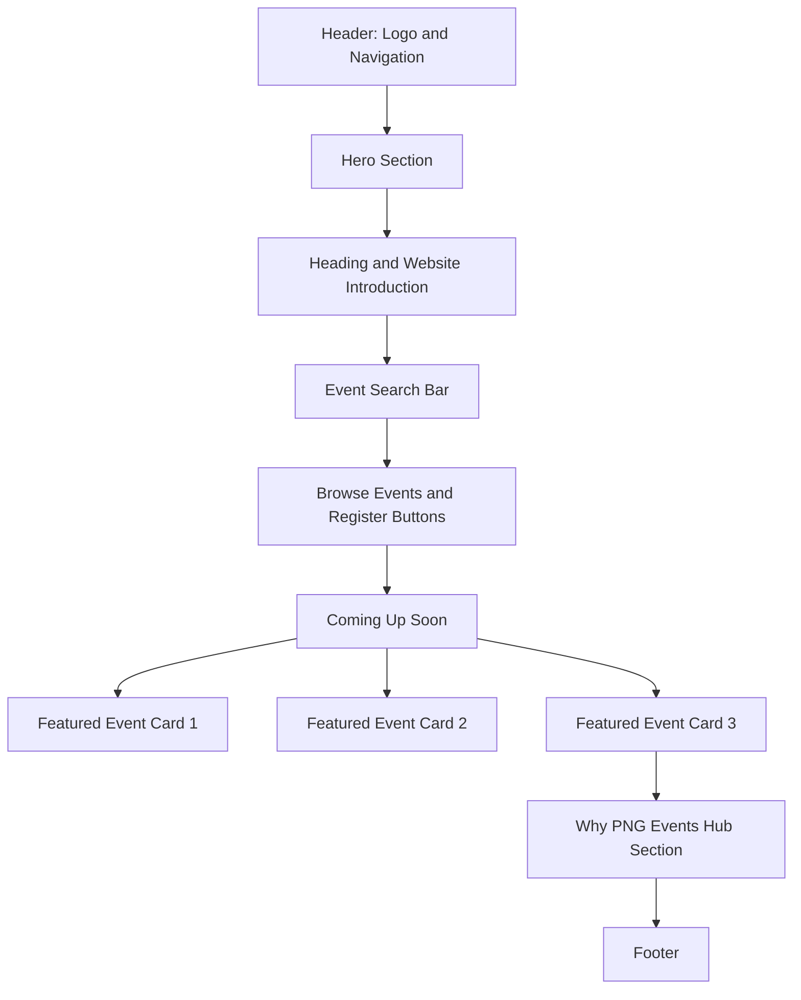
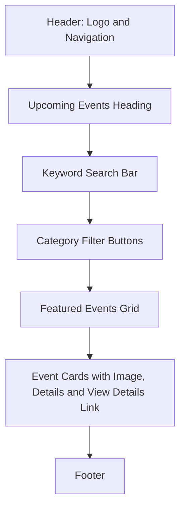
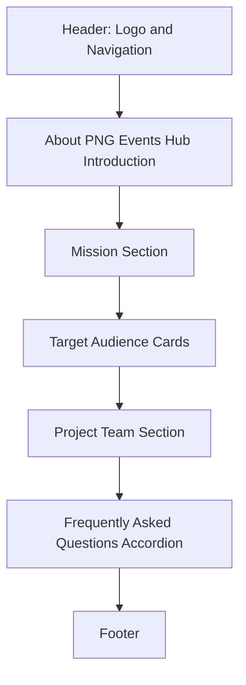
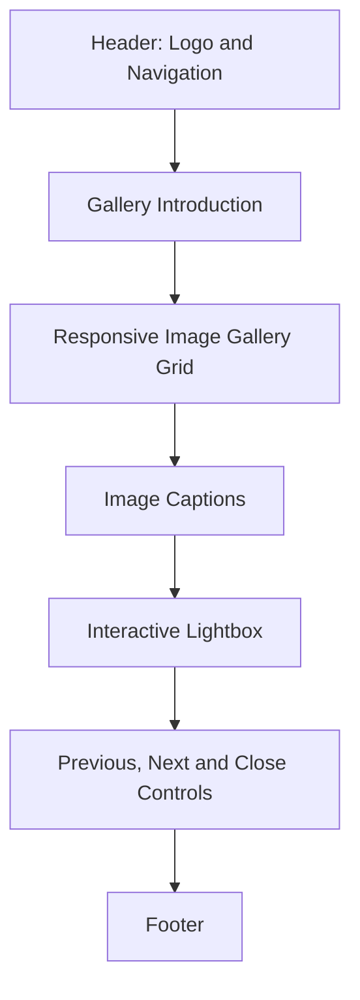
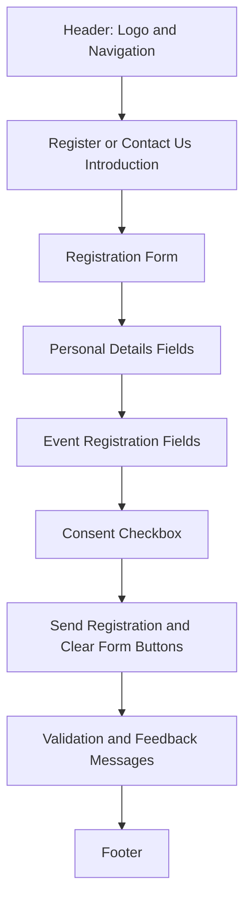

````markdown
# PNG Events Hub

PNG Events Hub is a multi-page website that helps people discover cultural, sports, music, education, and community events across Papua New Guinea. It addresses the problem of event information being shared through word of mouth or scattered social-media posts by bringing event listings, search, category filtering, registration, and event images into one website.

## Live Website

- Published URL: https://br737-code.github.io/Integrated-Final-Website/

## Project Team

| Name              | Student ID | Role / Key Contributions         |
| ----------------- | ---------- | -------------------------------- |
| Brendan MARAN     | 25530136   | Home and Navigation              |
| Lydia SAPMANGUA   | 24202380   | Events Directory                 |
| Shalom MANAGEN    | 25530201   | Responsive Styling & Integration |
| Yedi Yannah YUWOM | 2553029    | Community Gallery                |
| Dasha TELIKADAH   | 25530081   | About and FAQ                    |
| Joseph SEETO      | 25530061   | Events Page                      |

## Project Overview

- **Target audience:** Residents and families looking for local activities, students seeking campus events and workshops, and event organisers who want to reach a wider audience.
- **Project goals:** To provide a simple, central, and easy-to-read place to find events across Papua New Guinea, including their dates, locations, categories, and registration options.
- **Main user tasks:** Browse upcoming events, search by keyword or location, filter events by category, view event photographs, register for an event, and send a general enquiry.
- **Problem/opportunity addressed:** Community events are often advertised only through word of mouth or on separate social-media pages, which can make them difficult for people to find.

## Features

- Semantic multi-page HTML5 website with Home, Events, About, Gallery, and Contact pages.
- Responsive design for mobile, tablet, and desktop using media queries, flexible layouts, CSS Grid, and Flexbox.
- JavaScript feature 1: Home-page search sends a keyword to the Events page, where matching event cards are displayed.
- JavaScript feature 2: Events can be filtered by Cultural, Sports, Education, and Music categories, with a live result count and no-results message.
- JavaScript feature 3: The Gallery uses a native dialog lightbox with close, previous, next, keyboard-arrow, and touch-swipe controls.
- Accessible form with HTML and JavaScript validation for full name, email address, phone number, selected event, number of attendees, and consent.
- Meaningful feedback for form users through field-level error messages, `aria-invalid` attributes, a live status message, and a success confirmation.

## Site Structure

### Sitemap

```text
Home (index.html)
├── Events (events.html)
│   └── Contact and Register (contact.html)
├── About (about.html)
├── Gallery (gallery.html)
└── Contact and Register (contact.html)
```

### Pages and Purposes

- **Home:** Introduces PNG Events Hub, provides event search, highlights three upcoming events, and explains the website’s purpose.
- **About:** Explains the project mission, intended users, team roles, and frequently asked questions.
- **Services/Products:** No separate Services/Products page is included in the current website.
- **Contact:** Allows users to register for an event or send a general enquiry.
- **Other pages:** **Events** provides searchable and filterable event listings; **Gallery** displays six event-related images in an interactive lightbox.

## Design

### Wireframes

#### Home Page



#### Events Page



#### About Page



#### Gallery Page



#### Contact and Registration Page



### Design System

- Colour palette: Dark ink `#1c1a17`, white `#ffffff`, sand `#f1ebdd`, Papua New Guinea flag red `#c8102e`, gold `#fcd116`, green `#0e5a3a`, deep green `#0a3f29`, and blue `#1d4f91`.
- Typography: Bricolage Grotesque is used for headings, and Public Sans is used for body text. Both are loaded from Google Fonts.
- Layout/design system: The site uses shared design tokens, consistent containers, card layouts, rounded corners, shadows, a PNG-flag-colour woven strip, reusable buttons, and a shared header and footer design.
- Responsive approach: CSS media queries adapt layouts at 900px, 768px, 640px, 600px, and 480px. Flexible grids, wrapping controls, flexible cards, and mobile-specific navigation and lightbox layouts support smaller screens.

## Technologies Used

- HTML5
- CSS3, including Flexbox and Grid
- Vanilla JavaScript
- Git and GitHub

## Accessibility

- Semantic HTML structure using `header`, `nav`, `main`, `section`, `article`, `footer`, `figure`, `fieldset`, `legend`, and heading elements.
- Alternative text for content images and form labels for form controls.
- Keyboard navigation and visible focus through native buttons and links, visible focus styles, an accessible gallery dialog, Escape-key support for the home navigation menu, and arrow-key support for gallery navigation.
- Colour contrast: Dark text, white and sand backgrounds, visible blue focus outlines, and contrasting form-validation states are defined in the CSS. [ADD: confirm colour contrast with a contrast-checking tool]

## Testing

- **Functional testing:** Completed 12 test cases (F01-F12) covering mobile navigation, search, category filtering, FAQ accordion, gallery lightbox, form validation, character counter, navigation links, and skip links. All 12 tests passed, with 0 failures (100% pass rate).
- **Responsive testing:** Tested at 375px, 430px, 768px, 1024px, and 1440px+ viewports, using browser device emulation and real mobile, tablet, laptop, and monitor devices. All 12 responsive checks passed with 0 failures.
- **Browser compatibility testing:** Tested across seven desktop and mobile browser/operating-system combinations. No critical issues were found; Firefox showed one minor focus-outline colour difference.
- **HTML/CSS validation:** All five HTML pages and six CSS stylesheets passed validation with 0 errors. Accessibility checks also passed for semantic HTML, alt text, labels, keyboard navigation, focus visibility, contrast, ARIA attributes, skip links, touch targets, and reduced motion.
- **Usability testing:** No separate user usability-testing study is recorded in the testing report. Responsive and accessibility checks confirmed readable content, usable touch targets, keyboard access, and no horizontal overflow.
- **Testing report/evidence:** [View the PNG Events Hub Testing Report](PNG_Events_Hub_Testing_Report.docx)

## Installation / Running Locally

1. Clone the repository:

   ```bash
   git clone https://github.com/Br737-code/Integrated-Final-Website
   ```

2. Open the `Integrated-Final-Website` project folder.

3. Open `index.html` in a web browser, or run the project with a local development server.

## Repository Structure

```text
Integrated-Final-Website/
├── about.html
├── contact.html
├── events.html
├── gallery.html
├── index.html
├── README.md
├── css/
│   ├── about.css
│   ├── contact.css
│   ├── events.css
│   ├── gallery.css
│   ├── index.css
│   └── style.css
├── images/
│   ├── gallery-1.jpg
│   ├── gallery-2.jpg
│   ├── gallery-3.jpg
│   ├── gallery-4.jpg
│   ├── gallery-5.jpg
│   ├── gallery-6.jpg
│   └── img1.jpg
└── js/
    ├── about.js
    ├── contact.js
    ├── events.js
    ├── gallery.js
    └── index.js
```

## Individual Contribution Statement

| Team Member       | Contributions                                                                                       |
| ----------------- | --------------------------------------------------------------------------------------------------- |
| Brendan MARAN     | Created the Home page and navigation, and supervised the project.                                   |
| Lydia SAPMANGUA   | Created the Events Directory and event listings, and completed testing and report evidence.         |
| Shalom MANAGEN    | Completed responsive styling and integrated the website documentation.                              |
| Yedi Yannah YUWOM | Created the Community Gallery and image lightbox, and contributed 50% of the website documentation. |
| Dasha TELIKADAH   | Created the About page and FAQ accordion.                                                           |
| Joseph SEETO      | Contributed to the Events page and README file.                                                     |

## AI Use Declaration

Our team used AI tools during this project. Claude was used by five team members, and GitHub Copilot was used by one team member. Based on each member's own account, the team's use of AI fell into the following areas:

- **Code generation:** AI generated most of the website's HTML and CSS, and the small JavaScript files used for interactive features on each page.
- **Code integration:** merging different team members' code, resolving conflicts, and keeping the website consistent across pages.
- **Debugging:** finding and fixing errors in the code.
- **Git and GitHub guidance:** learning how to clone, commit, push, and merge using GitHub.

Because most of the code was AI-generated, the team's own contribution was in directing, reviewing, testing, and adapting it. The team reviewed and adapted the AI output in the following ways:

- Generated code was read and edited to fit our client's theme, content, and design.
- The JavaScript features were tested in the browser to confirm they work as intended on each page.
- Pages were tested on mobile, tablet, and desktop screen sizes.
- Merged code was checked after conflicts were resolved to make sure the site still worked.
- Team members can explain how the code in their sections works.

Individual members' detailed use of AI is not recorded here, but each member reported using these tools responsibly.

## License / Credits

### Fonts

- **Bricolage Grotesque** and **Public Sans** are provided by [Google Fonts](https://fonts.google.com/).

### Wikimedia Commons and Public-Domain Images

- **Amulet Figure, Papua New Guinea, Brücke Museum Berlin, 64964, view a** — Photograph by Nick Ash, Berlin; source: [Wikimedia Commons](https://commons.wikimedia.org/wiki/File:Amulet_Figure,_Papua_New_Guinea,_Brücke_Museum_Berlin,_64964,_view_a.jpg); licence: CC0 1.0.
- **Participants During First Aid Training organized By Noorain Global Organization Gombe** — Photograph by Usman Alhaji Usman; source: [Wikimedia Commons](https://commons.wikimedia.org/wiki/File:Participants_During_First_Aid_Training_organized_By_Noorain_Global_Organization_Gombe.png); licence: CC0 1.0.
- **KM23: Sports with local Papuans** — Photograph by Lance Cpl. Ricardo Ramirez, U.S. Marine Corps; source: [DVIDS](https://www.dvidshub.net/image/7945183/km23-sports-with-local-papuans); public domain.

### Unsplash Images

The following event-card images are loaded from Unsplash:

- Cultural celebration — [Unsplash source](https://images.unsplash.com/photo-1608501408162-d9db758dd88e)
- Interactive event booth — [Unsplash source](https://images.unsplash.com/photo-1750730677198-97439288abb7)
- Gardening workshop — [Unsplash source](https://images.unsplash.com/photo-1621460248083-6271cc4437a8)
- Educational seminar — [Unsplash source](https://images.unsplash.com/photo-1770096731083-5994253c1a6b)
- Community fun run — [Unsplash source](https://images.unsplash.com/photo-1613936360976-8f35cf0e5461)
- Coastal volleyball — [Unsplash source](https://images.unsplash.com/photo-1521138054413-5a47d349b7af)
- Mountain-bike ride — [Unsplash source](https://images.unsplash.com/photo-1627044185459-09e6dbc39444)
- Acoustic music performance — [Unsplash source](https://images.unsplash.com/photo-1471478331149-c72f17e33c73)
- Choir performance — [Unsplash source](https://images.unsplash.com/photo-1598300023303-a7af0627557c)
- Percussion performance — [Unsplash source](https://images.unsplash.com/photo-1523689119443-df96632084a1)

### Local Images - Source Required

The project contains the following local image files, but no creator, website, licence, or embedded metadata is recorded for them. Replace each placeholder with its real source before submitting.

- `images/img1.jpg` - Home-page hero image.
- `images/gallery-1.jpg` - Cultural festival dance image.
- `images/gallery-2.jpg` - PNG Kumuls celebration image.
- `images/gallery-3.jpg` - Meganesia concert image.
- `images/gallery-4.jpg` - Ela Beach craft market image.
- `images/gallery-5.jpg` - Computer-lab opening image.
- `images/gallery-6.jpg` - PNG Unitech graduation image.
````
